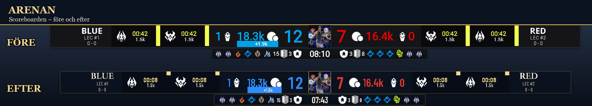

# Arenan – League Broadcast-stil för våra 5v5-customkvällar

Ett gladiator-/arenatema för [League Broadcast](https://leaguebroadcast.gg) (gratisversionen):
mörkblått, brons och guld, Cinzel + Barlow Condensed och gladiatorloggan.



| Var | Vad som är stylat |
|---|---|
| Champ select (`/pregame/v2`) | Pick & ban-raden, bronsramar, turneringsloggan i mitten |
| Under matchen (`/ingame/v2`) | Scoreboard, champion-flikar, färger och typsnitt på alla element |
| Post-game | – (kräver League Broadcast Basic, ingår inte) |

## Snabbstart – bara använda stilen

Allt du behöver finns i [`share/`](share/). Följ [`share/INSTRUKTIONER.md`](share/INSTRUKTIONER.md):
installera League Broadcast, importera `Arenan_pre.lbstyle` och `Arenan_in.lbstyle`
(Style Editor → klicka på stilsetets namn → **Import Style Set**) och lägg in
`http://localhost:58869/pregame/v2` och `http://localhost:58869/ingame/v2` som browser-källor i OBS.

**Glöm inte `/v2`** – den vanliga `/ingame/` visar League Broadcasts gamla layout utan stilen.

## Mappar

```
share/            det man skickar till andra: .lbstyle-filerna, instruktioner, skärmdumpar
arenan/style/     vår design som rå JSON (samma som i .lbstyle-filerna)
arenan/logo/      gladiator.png (turneringsloggan) + ett eget emblem som alternativ
tools/            skript för att underhålla stilen
```

## Verktyg (för den som vill ändra stilen)

Kräver Python 3 (+ Pillow för skärmdumpar) och Node 22+.

| Skript | Gör |
|---|---|
| `python tools/apply_arenan.py` | Lägger på stilen i League Broadcasts filer igen. **Stäng appen först.** Kräver att stilseten "Arenan" redan finns (importerade eller duplicerade). `--dry-run` visar bara vad som skulle ändras. |
| `python tools/outline.py <variant.json>` | Visar hur ett stilelement är uppbyggt (noder, färger, typsnitt). |
| `python tools/make_logo.py` | Ritar om emblemet i `arenan/logo/`. |
| `node tools/capture.mjs <url> <ut.png> [sek] [selector] [antal]` | Skärmdump av en overlay i 1920×1080 (headless Edge). League Broadcast måste köra mock-data. |
| `python tools/make_screenshots.py` | Gör delningsbilderna i `share/screenshots/` av råbilderna. |

### Bra att veta om League Broadcast

- Stilarna ligger i `%APPDATA%\BlueBottle\LeagueBroadcast\data\style\`. Filer under `preset/` skrivs över varje gång appen startar – ändra bara egna kopior (Duplicate style set / Duplicate variant).
- `customCss` på ett element läggs in som en stilmall för hela sidan, så ett `:root { --lb-overlay-… }`-block färgar om alla element.
- Typsnitt som anges i `fontFamily` hämtar appen själv från Google Fonts.
- Turneringsloggan gäller hela säsongen (Style Editor → Global Styles → Tournament Icon), inte ett enskilt stilset.

## Begränsningar

- Testat med League Broadcasts mock-data, inte i en riktig spectatad match än.
- Importen av `.lbstyle` är inte testad på en annan dator.
- `gladiator.png` är en meme med en filmbild och lagloggor som andra äger – okej för en privat stream med kompisar,
  men använd emblemet i `arenan/logo/` om ni streamar publikt.

League Broadcast är en produkt från BlueBottle GmbH; det här repot är inte kopplat till dem eller till Riot Games.
