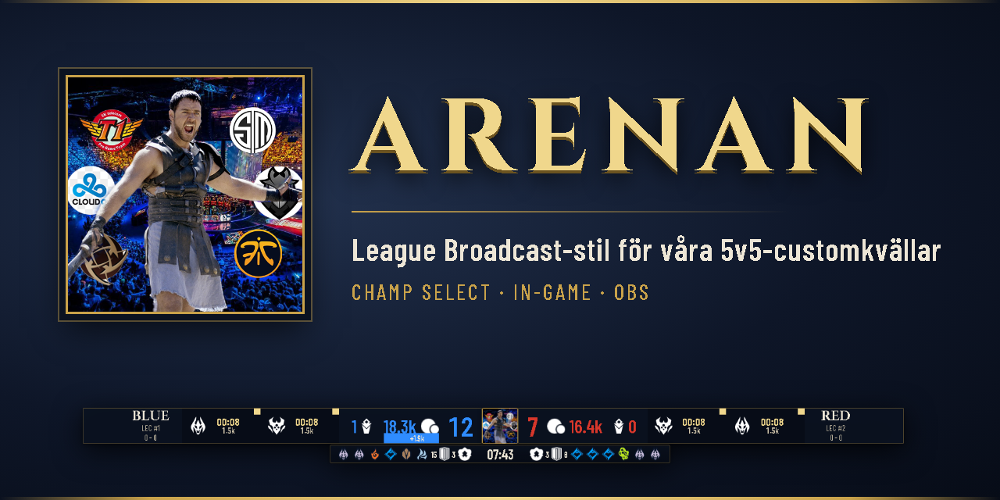
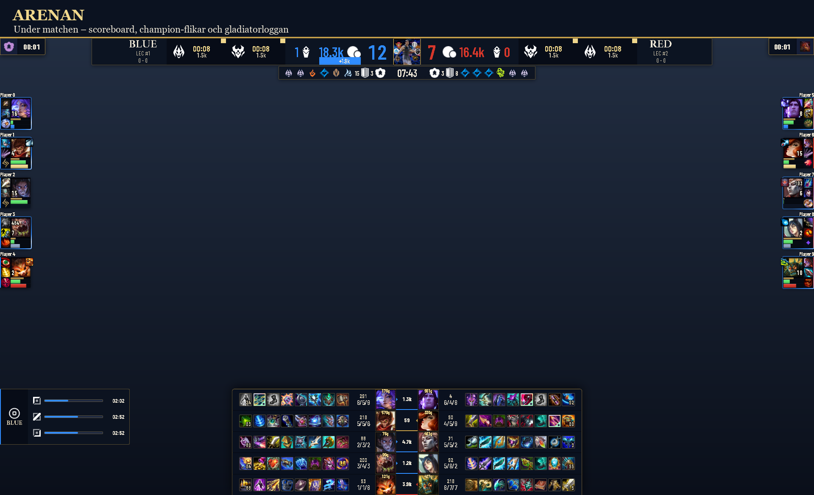
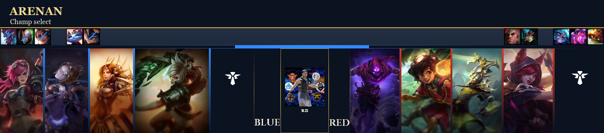
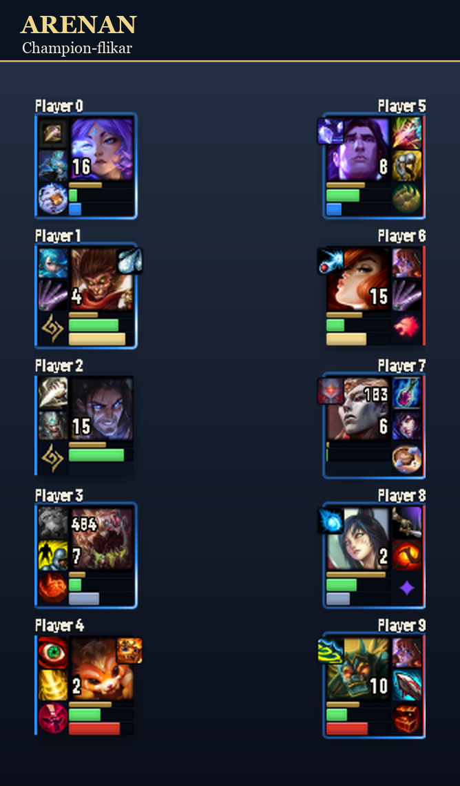
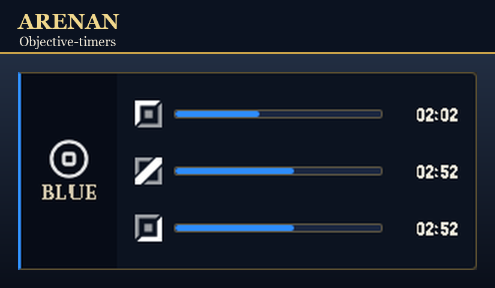

Vår egen stil till League Broadcast för customkvällarna.
Bara den som kör OBS behöver göra det här.

## Så här gör du

**1. Ladda ner de två filerna**

- [Arenan_pre.lbstyle](Arenan_pre.lbstyle?raw=true)
- [Arenan_in.lbstyle](Arenan_in.lbstyle?raw=true)

**2. Installera League Broadcast**

Gratis från [leaguebroadcast.gg/download](https://leaguebroadcast.gg/download). Logga in.

**3. Importera filerna**

Öppna **Style Editor** i menyn till vänster.

- Fliken **Pre**: klicka på namnet högst upp → **Import Style Set** → välj `Arenan_pre.lbstyle`.
- Fliken **In**: klicka på namnet högst upp → **Import Style Set** → välj `Arenan_in.lbstyle`.

Högst upp ska det nu stå **Arenan** på båda flikarna.

**4. Lägg in i OBS**

Lägg till två **Browser**-källor, storlek 1920 × 1080:

- Champ select: `http://localhost:58869/pregame/v2`
- Under matchen: `http://localhost:58869/ingame/v2`

Klart! Ha League Broadcast igång när du streamar.

Fastnar du? Hör av dig på Discord.

## Så ser det ut

 

Mappen `underhall` behöver du inte – den är bara till för att ändra stilen.
