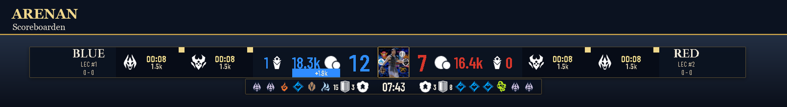
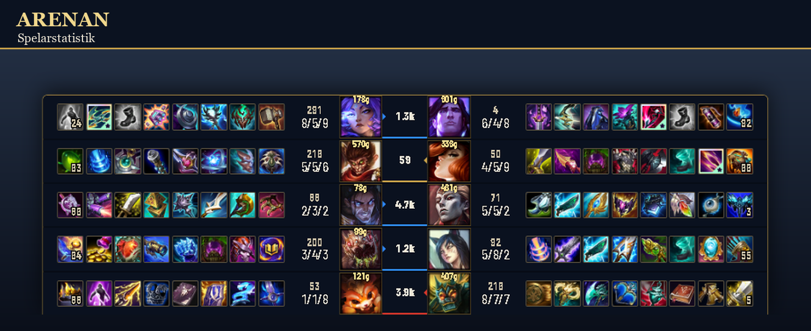
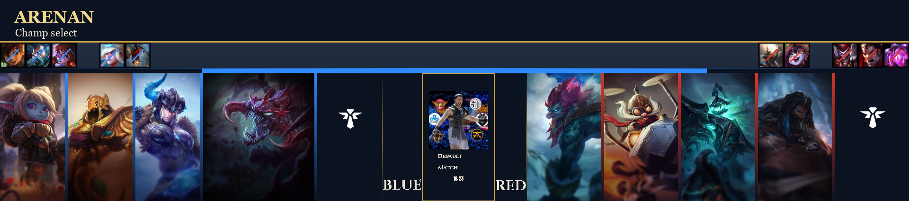
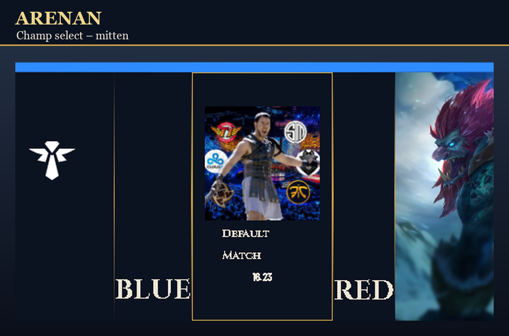

# Arenan – League Broadcast-stil för våra 5v5-customkvällar

Vår egen stil för streamen: mörkblått, brons och guld, och gladiatorn som turneringslogga.



## Gör så här (ca 5 minuter)

Du behöver bara **två filer**. Allt annat i det här repot kan du strunta i.

**1. Ladda ner filerna** – klicka på länkarna så laddas de ner direkt:

- **[Arenan_pre.lbstyle](share/Arenan_pre.lbstyle?raw=true)** – champ select
- **[Arenan_in.lbstyle](share/Arenan_in.lbstyle?raw=true)** – under matchen

**2. Installera League Broadcast** (gratis) från [leaguebroadcast.gg/download](https://leaguebroadcast.gg/download) och logga in.

**3. Importera filerna.** Öppna **Style Editor** i menyn till vänster.

- Välj fliken **Pre**. Klicka på namnet högst upp (det står *BottomRow*) → **Import Style Set** → välj `Arenan_pre.lbstyle`.
- Välj fliken **In**. Klicka på namnet högst upp (det står *DefaultIngame*) → **Import Style Set** → välj `Arenan_in.lbstyle`.
- Kolla att det står **Arenan** högst upp på båda flikarna. Gör det inte det: klicka på namnet och välj Arenan.

**4. Lägg in i OBS.** Lägg till två källor av typen **Browser**, storlek **1920 × 1080**:

| Källa | Adress |
|---|---|
| Champ select | `http://localhost:58869/pregame/v2` |
| Under matchen | `http://localhost:58869/ingame/v2` |

> **Glöm inte `/v2` i slutet** – annars syns inte stilen.

Klart! League Broadcast måste vara igång när du streamar. Bilderna nedan visar hur det ska se ut.

**Ska du bara casta (prata)?** Då behöver du inte göra något av det här – bara den som kör OBS och spectatar matchen behöver det.

**Fastnar du?** Hör av dig på Discord.

## Så ser det ut

### Under matchen


### Champion-flikar


### Spelarstatistik


### Objective-timers


### Champ select




---

## För den som vill ändra stilen

*Allt härifrån och neråt behövs inte för att använda stilen.*

| Var | Vad som är stylat |
|---|---|
| Champ select (`/pregame/v2`) | Pick & ban-raden, bronsramar, turneringsloggan i mitten |
| Under matchen (`/ingame/v2`) | Scoreboard, champion-flikar, färger och typsnitt på alla element |
| Post-game | – (kräver League Broadcast Basic, ingår inte) |

### Mappar

```
share/            det man skickar till andra: .lbstyle-filerna, instruktioner, skärmdumpar
arenan/style/     vår design som rå JSON (samma som i .lbstyle-filerna)
arenan/logo/      gladiator.png (turneringsloggan) + ett eget emblem som alternativ
tools/            skript för att underhålla stilen
```

### Verktyg

Kräver Python 3 (+ Pillow för skärmdumpar) och Node 22+.

| Skript | Gör |
|---|---|
| `python tools/apply_arenan.py` | Lägger på stilen i League Broadcasts filer igen. **Stäng appen först.** Kräver att stilseten "Arenan" redan finns (importerade eller duplicerade). `--dry-run` visar bara vad som skulle ändras. |
| `python tools/outline.py <variant.json>` | Visar hur ett stilelement är uppbyggt (noder, färger, typsnitt). |
| `python tools/make_logo.py` | Ritar om emblemet i `arenan/logo/`. |
| `node tools/capture.mjs <url> <ut.png> [sek] [selector] [antal]` | Skärmdump av en overlay i 1920×1080 (headless Edge). League Broadcast måste köra mock-data. |
| `python tools/make_screenshots.py` | Gör delningsbilderna i `share/screenshots/` av råbilderna. |

#### Bra att veta om League Broadcast

- Stilarna ligger i `%APPDATA%\BlueBottle\LeagueBroadcast\data\style\`. Filer under `preset/` skrivs över varje gång appen startar – ändra bara egna kopior (Duplicate style set / Duplicate variant).
- `customCss` på ett element läggs in som en stilmall för hela sidan, så ett `:root { --lb-overlay-… }`-block färgar om alla element.
- Typsnitt som anges i `fontFamily` hämtar appen själv från Google Fonts.
- Turneringsloggan gäller hela säsongen (Style Editor → Global Styles → Tournament Icon), inte ett enskilt stilset.

### Begränsningar

- Testat med League Broadcasts mock-data, inte i en riktig spectatad match än.
- Importen av `.lbstyle` är inte testad på en annan dator.
- `gladiator.png` är en meme med en filmbild och lagloggor som andra äger – okej för en privat stream med kompisar,
  men använd emblemet i `arenan/logo/` om ni streamar publikt.

League Broadcast är en produkt från BlueBottle GmbH; det här repot är inte kopplat till dem eller till Riot Games.
